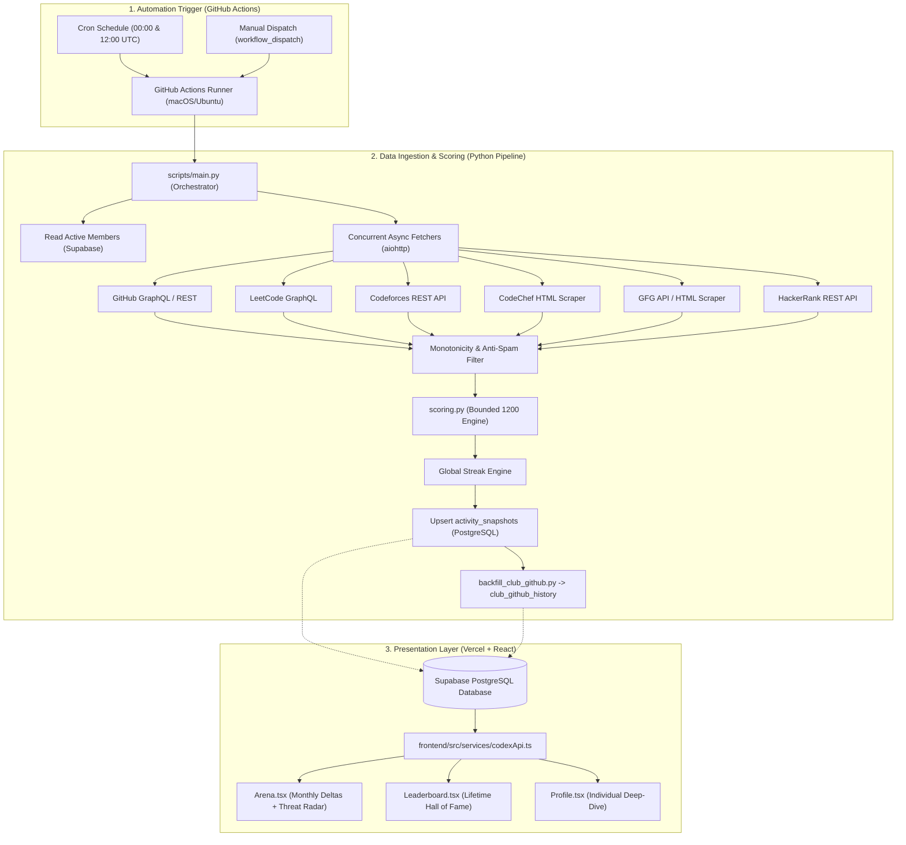
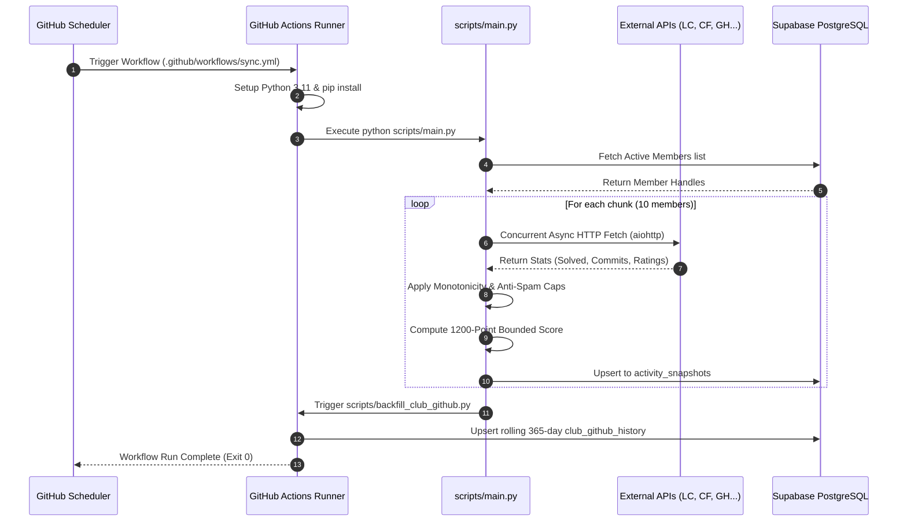

# ⚔️ CODEX Activity Tracker: Leaderboard & Arena Architecture Manual

> **Comprehensive Technical Specification & Architecture Manual**  
> Covers the full data pipeline, web scraping engines, anti-fraud algorithms, storage models, scoring math, frontend reactive UI, and GitHub Actions automation that power **The Code Colosseum (Leaderboard)** and **The Arena (Monthly Combat)**.

---

## 📑 Table of Contents

1. [Executive Summary & Core Philosophy](#1-executive-summary--core-philosophy)
2. [High-Level System Architecture](#2-high-level-system-architecture)
3. [Full Technology Stack](#3-full-technology-stack)
4. [Database & Storage Architecture (Supabase PostgreSQL)](#4-database--storage-architecture-supabase-postgresql)
   - [A. `members` Table](#a-members-table)
   - [B. `activity_snapshots` Table (Time-Series Engine)](#b-activity_snapshots-table-time-series-engine)
   - [C. `club_github_history` Table](#c-club_github_history-table)
   - [D. Complex JSONB Schemas](#d-complex-jsonb-schemas)
5. [Data Ingestion Pipeline & Web Scrapers (`scripts/`)](#5-data-ingestion-pipeline--web-scrapers-scripts)
   - [Batch Processing & Concurrency](#batch-processing--concurrency)
   - [Platform Scraper Deep-Dive](#platform-scraper-deep-dive)
   - [Resilience & Anti-Fraud Guardrails](#resilience--anti-fraud-guardrails)
6. [Scoring Engine & Mathematical Models (`scripts/scoring.py`)](#6-scoring-engine--mathematical-models-scriptsscoringpy)
   - [DSA Score (Max 500 Pts)](#dsa-score-max-500-pts)
   - [Development Score (Max 500 Pts)](#development-score-max-500-pts)
   - [Consistency Bonus (Max 200 Pts)](#consistency-bonus-max-200-pts)
   - [Total Score Aggregation](#total-score-aggregation)
7. [The Arena: Monthly Combat Engine (`Arena.tsx` & `codexApi.ts`)](#7-the-arena-monthly-combat-engine-arenatsx--codexapits)
   - [Monthly Delta vs. Lifetime Value](#monthly-delta-vs-lifetime-value)
   - [Scraper Backfill Detection & Daily Problem Capping](#scraper-backfill-detection--daily-problem-capping)
   - [Transparent Platform Verification (LC, CF, CC, GFG)](#transparent-platform-verification-lc-cf-cc-gfg)
   - [Division XP Formulas & Threat Radar](#division-xp-formulas--threat-radar)
   - [Rank Titles, Streaks & Gamification Badges](#rank-titles-streaks--gamification-badges)
8. [The Leaderboard: Lifetime Hall of Fame (`Leaderboard.tsx`)](#8-the-leaderboard-lifetime-hall-of-fame-leaderboardtsx)
   - [Sorting Modes & Client-Side Rank Maps](#sorting-modes--client-side-rank-maps)
   - [Club Command Center & Skill Analytics](#club-command-center--skill-analytics)
   - [365-Day Rolling GitHub Heatmap](#365-day-rolling-github-heatmap)
9. [Automation & CI/CD Pipeline (GitHub Actions)](#9-automation--cicd-pipeline-github-actions)
   - [Workflow Trigger & Scheduling](#workflow-trigger--scheduling)
   - [Step-by-Step Execution Sequence](#step-by-step-execution-sequence)
   - [Secrets & Environment Management](#secrets--environment-management)
10. [Local Development & Setup Guide](#10-local-development--setup-guide)
11. [Troubleshooting & Frequently Asked Questions](#11-troubleshooting--frequently-asked-questions)

---

## 1. Executive Summary & Core Philosophy

The **CODEX Activity Tracker** is an automated competitive programming and open-source intelligence platform. It tracks, aggregates, normalizes, and gamifies the daily engineering activity of CODEX members across six major platforms:
- **Competitive Programming & DSA:** LeetCode, Codeforces, CodeChef, GeeksforGeeks, HackerRank.
- **Software Engineering & Open Source:** GitHub.

The platform solves two fundamental challenges in collegiate developer communities:
1. **Lifetime Recognition (The Leaderboard):** Rewarding long-term dedication, cumulative problem volume, high contest ratings, and sustainable open-source contributions.
2. **Short-Term Momentum (The Arena):** Providing an active monthly battleground where veterans and fresh recruits compete on a level playing field based exclusively on current-month output. Every month resets the scores, eliminating legacy score stagnation.

```
┌────────────────────────────────────────────────────────────────────────┐
│                        CODEX ACTIVITY ECOSYSTEM                        │
├──────────────────────────────────┬─────────────────────────────────────┤
│   THE LEADERBOARD (Lifetime)     │        THE ARENA (Monthly)          │
│   • Global Cumulative Points     │   • Fresh Monthly Reset (Day 1)     │
│   • 1,200 Max Bounded Score      │   • Pure Delta (Growth) Tracking    │
│   • Peak Ratings & Career Stats  │   • Division Clashes (DSA vs DEV)   │
│   • Hall of Fame Standings       │   • Threat Radar & Combat Titles    │
└──────────────────────────────────┴─────────────────────────────────────┘
```

---

## 2. High-Level System Architecture

The ecosystem operates as a decoupled, automated pipeline comprising three distinct stages:



---

## 3. Full Technology Stack

| Layer | Technology | Version | Purpose |
| :--- | :--- | :--- | :--- |
| **Frontend Framework** | React | 19.x | High-performance reactive UI with component modularity |
| **Language** | TypeScript | 5.x | Strict end-to-end type safety |
| **Build & Dev Tool** | Vite | 5.x | Ultra-fast HMR and optimized production bundling |
| **Styling** | Tailwind CSS | 4.x | Utility-first styling with custom Neo-Brutalist design tokens |
| **Animations** | Framer Motion & GSAP | 12.x / 3.x | Kinetic physics-based page transitions, radar pulses, card tilt |
| **Database & Auth** | Supabase (PostgreSQL) | 15+ | Relational time-series storage, PostgREST API, RLS |
| **Backend Runtime** | Python | 3.11+ | Asynchronous data ingestion and mathematical calculations |
| **Async Networking** | `aiohttp` / `asyncio` | Latest | Non-blocking concurrent requests with connection pooling |
| **HTML Parsing** | `BeautifulSoup4` / `re` | Latest | Extracting structured metrics from SSR web profiles |
| **CI/CD Automation** | GitHub Actions | v4 / v5 | Twice-daily cron execution and headless pipeline management |
| **Hosting** | Vercel Edge Network | Production | Global edge hosting with automated CI deployment from `main` |

---

## 4. Database & Storage Architecture (Supabase PostgreSQL)

All relational data is maintained in Supabase. The system is designed around time-series immutability: instead of overwriting a user's record on every sync, the platform preserves historical daily snapshots.

### A. `members` Table
The source of truth for user registration, identity, and linked competitive handles.

| Column | Type | Constraints | Description |
| :--- | :--- | :--- | :--- |
| `id` | `UUID` | Primary Key, `default gen_random_uuid()` | Unique member identifier |
| `full_name` | `VARCHAR` | NOT NULL | Member's display name |
| `roll_number` | `VARCHAR` | UNIQUE, Nullable | University institutional roll ID |
| `avatar_url` | `TEXT` | Nullable | Remote profile image avatar |
| `bio` | `TEXT` | Nullable | Developer biography or quote |
| `is_active` | `BOOLEAN` | Default `TRUE` | Soft-disable switch for alumni/inactive users |
| `github_handle` | `VARCHAR` | Nullable | GitHub username (used for commit/PR sync) |
| `leetcode_handle`| `VARCHAR` | Nullable | LeetCode handle |
| `codeforces_handle`| `VARCHAR`| Nullable | Codeforces handle |
| `codechef_handle`| `VARCHAR` | Nullable | CodeChef handle |
| `gfg_handle` | `VARCHAR` | Nullable | GeeksforGeeks handle |
| `hackerrank_handle`| `VARCHAR`| Nullable | HackerRank handle |
| `created_at` | `TIMESTAMPTZ` | Default `NOW()` | Registration timestamp |

---

### B. `activity_snapshots` Table (Time-Series Engine)
The core analytical table. Every day at 00:00/12:00 UTC, a snapshot record is created or updated for each member.

- **Composite Primary Key / Unique Constraint:** `(member_id, snapshot_date)`

```sql
CREATE TABLE activity_snapshots (
    id UUID PRIMARY KEY DEFAULT gen_random_uuid(),
    member_id UUID REFERENCES members(id) ON DELETE CASCADE,
    snapshot_date DATE NOT NULL,
    
    -- Calculated Scores
    total_score NUMERIC(7, 2) DEFAULT 0.0,
    dsa_score NUMERIC(7, 2) DEFAULT 0.0,
    dev_score NUMERIC(7, 2) DEFAULT 0.0,
    
    -- Global Activity & Streaks
    active_days INT DEFAULT 0,
    current_streak INT DEFAULT 0,
    max_streak INT DEFAULT 0,
    contests_attended INT DEFAULT 0,
    total_submissions INT DEFAULT 0,
    
    -- GitHub Metrics
    raw_github_commits INT DEFAULT 0,
    valid_github_commits INT DEFAULT 0,
    github_contributions INT DEFAULT 0,
    github_repos INT DEFAULT 0,
    github_prs INT DEFAULT 0,
    github_issues INT DEFAULT 0,
    
    -- LeetCode Metrics
    leetcode_easy INT DEFAULT 0,
    leetcode_medium INT DEFAULT 0,
    leetcode_hard INT DEFAULT 0,
    leetcode_total INT DEFAULT 0,
    leetcode_rating NUMERIC(7, 2) DEFAULT 0.0,
    leetcode_max_rating NUMERIC(7, 2) DEFAULT 0.0,
    leetcode_contests INT DEFAULT 0,
    
    -- Codeforces Metrics
    codeforces_rating INT DEFAULT 0,
    codeforces_max_rating INT DEFAULT 0,
    codeforces_solved INT DEFAULT 0,
    codeforces_contests INT DEFAULT 0,
    codeforces_rank_title VARCHAR DEFAULT 'Unrated',
    
    -- CodeChef Metrics
    codechef_rating INT DEFAULT 0,
    codechef_max_rating INT DEFAULT 0,
    codechef_solved INT DEFAULT 0,
    codechef_contests INT DEFAULT 0,
    
    -- GeeksforGeeks Metrics
    gfg_score INT DEFAULT 0,
    gfg_solved INT DEFAULT 0,
    gfg_school INT DEFAULT 0,
    gfg_basic INT DEFAULT 0,
    gfg_easy INT DEFAULT 0,
    gfg_medium INT DEFAULT 0,
    gfg_hard INT DEFAULT 0,
    
    -- HackerRank Metrics
    hackerrank_badges INT DEFAULT 0,
    
    -- Rich Metadata
    topic_stats JSONB DEFAULT '{}'::jsonb,
    badges_detail JSONB DEFAULT '[]'::jsonb,
    
    created_at TIMESTAMPTZ DEFAULT NOW(),
    UNIQUE (member_id, snapshot_date)
);
```

---

### C. `club_github_history` Table
Stores the aggregated 365-day rolling commit calendar across all active members of the community. Powers the interactive GitHub Heatmap component on the Leaderboard.

| Column | Type | Description |
| :--- | :--- | :--- |
| `date` | `DATE` (Primary Key) | Calendar date (`YYYY-MM-DD`) |
| `commits` | `INT` | Total sum of all valid commits pushed by club members on that day |

---

### D. Complex JSONB Schemas

#### 1. `topic_stats` Schema
Aggregates problem tags across multiple platforms, normalizing variations (e.g., `two-pointer-algorithm` vs `Two Pointers`):
```json
{
  "leetcode": {
    "Dynamic Programming": 42,
    "Binary Search": 28,
    "Graph": 15
  },
  "codechef": {
    "Arrays": 35,
    "Greedy": 20
  },
  "gfg": {
    "Tree": 18,
    "Strings": 30
  },
  "hackerrank": {
    "Java": 10,
    "Problem Solving": 25
  }
}
```

#### 2. `badges_detail` Schema
Maintains platform achievements and visual badges:
```json
[
  {
    "platform": "leetcode",
    "id": "50-days-2026",
    "name": "50 Days Badge 2026",
    "icon": "https://assets.leetcode.com/static_assets/marketing/2026-50.png"
  },
  {
    "platform": "hackerrank",
    "id": "problem-solving-5-star",
    "name": "Problem Solving (5 Star)"
  }
]
```

---

## 5. Data Ingestion Pipeline & Web Scrapers (`scripts/`)

The Python backend (`scripts/main.py`) executes as an automated worker that processes all members in asynchronous batches.

### Batch Processing & Concurrency
- **Batching:** Members are divided into chunks (`CHUNK_SIZE = 10`).
- **Sleep Intervals:** Between chunks, the script waits `INTER_CHUNK_SLEEP = 3` seconds.
- **Connection Reuse:** A shared `aiohttp.ClientSession` with a `TCPConnector(limit=50)` manages pooled HTTP keep-alives.
- **Timeouts:** Every individual fetch request is wrapped in an explicit timeout (`REQUEST_TIMEOUT = 12` seconds) to avoid stalling the pipeline.

```
Members List ──> Chunk 1 (10) ──> aiohttp.gather ──> Sleep 3s ──> Chunk 2 (10) ──> ...
```

---

### Platform Scraper Deep-Dive

#### 1. LeetCode (`scripts/fetchers/leetcode.py`)
- **Protocol:** LeetCode GraphQL API (`https://leetcode.com/graphql`).
- **Queries:** 
  1. `userContestRankingInfo`: Retrieves current contest rating, global ranking, and contest attendances.
  2. `userProfileUserQuestionProgressV2`: Retrieves difficulty breakdown (`numAcceptedQuestions`: Easy, Medium, Hard, and Total).
  3. `skillStats`: Extracts solved counts grouped into Fundamental, Intermediate, and Advanced topics.
  4. `userBadges`: Fetches earned badge metadata and SVGs.

#### 2. Codeforces (`scripts/fetchers/codeforces.py`)
- **Protocol:** Official Codeforces REST API.
- **Endpoints:**
  - `user.info?handles={handle}`: Retrieves current rating, `maxRating`, and competitive title rank (e.g., `Candidate Master`, `Expert`).
  - `user.status?handle={handle}&from=1&count=10000`: Iterates through submission logs, filtering only submissions with `verdict == "OK"`. Calculates distinct solved problem IDs (`contestId + index`).

#### 3. CodeChef (`scripts/fetchers/codechef.py`)
- **Protocol:** HTTP Scraping via `aiohttp` + `BeautifulSoup4`.
- **Target:** `https://www.codechef.com/users/{handle}`.
- **Extraction:**
  - Uses CSS selectors to read current rating (`.rating-number`), peak rating (`.rating-header small`), and star badge.
  - Regex scans the problems section to extract the total count of fully solved practice and contest problems.

#### 4. GeeksforGeeks (`scripts/fetchers/gfg.py`)
- **Protocol:** GFG Public Profile REST API / Server-Side Rendered Scraping.
- **Target:** `https://auth.geeksforgeeks.org/user/{handle}/practice/`.
- **Extraction:** Captures overall coding score, total problems solved, and granular category counts: `School`, `Basic`, `Easy`, `Medium`, and `Hard`.

#### 5. HackerRank (`scripts/fetchers/hackerrank.py`)
- **Protocol:** HackerRank Internal REST API.
- **Target:** `https://www.hackerrank.com/rest/hackers/{handle}/badges`.
- **Extraction:** Sums the total earned stars and badges across technical domains (Algorithms, Data Structures, Python, C++, SQL).

#### 6. GitHub (`scripts/fetchers/github.py`)
- **Protocol:** GitHub GraphQL API + REST v3 + SVG Contribution Calendar Scraping.
- **Metrics Collected:**
  - Public repository count (`public_repos`).
  - Total pull requests authored (`type:pr author:{handle}`).
  - Total issues opened (`type:issue author:{handle}`).
  - Contribution graph commits over the trailing 365 days.

---

### Resilience & Anti-Fraud Guardrails

```
             Fetched Data from External API
                          │
                          ▼
            Is Metric < Yesterday's Snapshot?
                    /           \
                 YES             NO
                  │               │
                  ▼               ▼
      Apply Monotonicity Fallback  Accept New Value
      (Keep Yesterday's High Score)
                          │
                          ▼
             Is Platform = GitHub Commits?
                    /           \
                 YES             NO
                  │               │
                  ▼               ▼
       Compute Daily Delta        Proceed
       Cap Delta at +15 max
```

#### 1. Monotonicity Enforcement (No Dropped Stats)
If an external API goes down, times out, or returns a lower number of solved problems than the previous day (e.g., if a user makes a GitHub repository private or deletes a submission):
- The pipeline queries the member's most recent valid record (`yesterday_snap`).
- If `current_val < yesterday_val`, the script discards the regression and restores yesterday's value.
- **Rule:** *A developer's lifetime metric can never decrease due to network or scraping errors.*

#### 2. Anti-Spam Commit Throttling (Bot Protection)
GitHub contributions can easily be exploited via scripted dummy commits.
- The pipeline tracks both `raw_github_commits` and `valid_github_commits`.
- When calculating the daily delta:
  $$\Delta_{\text{commits}} = \max(0, \text{raw\_commits}_{\text{today}} - \text{raw\_commits}_{\text{yesterday}})$$
- A daily ceiling of **15 commits** is enforced:
  $$\Delta_{\text{valid}} = \min(15, \Delta_{\text{commits}})$$
  $$\text{valid\_commits}_{\text{today}} = \text{valid\_commits}_{\text{yesterday}} + \Delta_{\text{valid}}$$
- Pushing 500 automated commits in a single day will only grant 15 valid points.

#### 3. Unified Global Streak Engine
CODEX calculates a cross-platform streak rather than relying on individual platform counters:
1. Calculates cumulative daily activity:
   $$\text{Total Activity} = \sum \text{Solved Problems} + \text{Commits} + \text{PRs} + \text{Issues} + \text{Badges}$$
2. Compares:
   - If $\text{Total Activity}_{\text{today}} > \text{Total Activity}_{\text{yesterday}}$, user was active today $\rightarrow$ `current_streak = base_streak + 1`.
   - If user was active yesterday but hasn't coded yet today, the streak remains preserved awaiting activity.
   - If user missed coding yesterday entirely, `current_streak` resets to 0.
3. Automatically updates `max_streak = max(max_streak, current_streak)`.

#### 4. Auto-Onboarding Baseline Seeding (Arena Anti-Spike)
When a new user joins CODEX midway through a month:
- Without intervention, their lifetime solved questions (e.g., 400 LeetCode problems) would appear as a 400-problem spike on day one, breaking the Arena leaderboard.
- **The Fix:** The sync script detects `_is_new_member == True`. It automatically inserts an identical clone of their stats backdated to the **1st of the current month**.
- Result: Baseline equals current score $\rightarrow$ Initial monthly delta is 0 $\rightarrow$ They only gain Arena XP for questions solved after joining.

---

## 6. Scoring Engine & Mathematical Models (`scripts/scoring.py`)

The platform converts multi-platform activity into a **bounded Developer Score capped at 1,200 points**. It enforces a balanced **500 / 500 split** between DSA and Development, with a **200-point Consistency Bonus**.

```
┌────────────────────────────────────────────────────────────────────────┐
│                   TOTAL DEVELOPER SCORE (MAX 1,200)                    │
├─────────────────────┬─────────────────────┬────────────────────────────┤
│   DSA SCORE         │   DEV SCORE         │   CONSISTENCY BONUS        │
│   Max: 500 Points   │   Max: 500 Points   │   Max: 200 Points          │
│   • Rating (250)    │   • Commits (200)   │   • Active Days (100)      │
│   • Volume (150)    │   • PRs (175)       │   • Max Streak (100)       │
│   • Contests (100)  │   • Issues (75)     │                            │
│                     │   • Repos (50)      │                            │
└─────────────────────┴─────────────────────┴────────────────────────────┘
```

---

### DSA Score (Max 500 Pts)

$$\text{DSA Score} = \min(500, \text{Rating Score} + \text{Solved Score} + \text{Contest Score})$$

#### 1. Rating Score (Max 250 Pts)
Rewards competitive skill level based on peak platform ratings:
- **Codeforces (Max 100 pts):** Base 800, Target 2,000 (Candidate Master):
  $$\text{CF Pts} = \min\left(100, \frac{\max(0, \text{CF}_{\text{rating}} - 800)}{1200} \times 100\right)$$
- **LeetCode (Max 100 pts):** Base 1,400, Target 2,200 (Guardian):
  $$\text{LC Pts} = \min\left(100, \frac{\max(0, \text{LC}_{\text{rating}} - 1400)}{800} \times 100\right)$$
- **CodeChef (Max 50 pts):** Base 1,000, Target 2,000 (5-Star):
  $$\text{CC Pts} = \min\left(50, \frac{\max(0, \text{CC}_{\text{rating}} - 1000)}{1000} \times 50\right)$$

#### 2. Solved Volume Score (Max 150 Pts)
Rewards problem practice volume, heavily weighted by difficulty:
- **LeetCode Weighted (Max 75 pts):** Target 1,500 weighted points
  $$\text{LC Weight} = (\text{Easy} \times 1) + (\text{Medium} \times 3) + (\text{Hard} \times 6)$$
  $$\text{LC Solved Pts} = \min\left(75, \frac{\text{LC Weight}}{1500} \times 75\right)$$
- **Codeforces Solved (Max 50 pts):** Target 250 solved problems
  $$\text{CF Solved Pts} = \min\left(50, \frac{\text{CF Solved}}{250} \times 50\right)$$
- **Other Platforms (GFG, CodeChef, HackerRank) (Max 25 pts):** Target 300 combined volume
  $$\text{GFG Weight} = (\text{Basic} \times 0.5) + (\text{Easy} \times 1) + (\text{Medium} \times 3) + (\text{Hard} \times 6)$$
  $$\text{Other Volume} = \text{GFG Weight} + (\text{CC Solved} \times 2) + (\text{HR Badges} \times 5)$$
  $$\text{Other Volume Pts} = \min\left(25, \frac{\text{Other Volume}}{300} \times 25\right)$$

#### 3. Contest Participation (Max 100 Pts)
Target: 50 contests across all platforms:
$$\text{Contest Pts} = \min\left(100, \frac{\text{Total Contests}}{50} \times 100\right)$$

---

### Development Score (Max 500 Pts)

$$\text{Dev Score} = \min(500, \text{Commits Pts} + \text{PRs Pts} + \text{Issues Pts} + \text{Repos Pts})$$

- **Valid GitHub Commits (Max 200 pts):** Target: 1,000 valid commits
  $$\text{Commits Pts} = \min\left(200, \frac{\text{valid\_github\_commits}}{1000} \times 200\right)$$
- **Pull Requests (Max 175 pts):** Target: 20 PRs (heavily incentivizes collaboration over solo commits)
  $$\text{PRs Pts} = \min\left(175, \frac{\text{github\_prs}}{20} \times 175\right)$$
- **GitHub Issues (Max 75 pts):** Target: 25 issues
  $$\text{Issues Pts} = \min\left(75, \frac{\text{github\_issues}}{25} \times 75\right)$$
- **Public Repositories (Max 50 pts):** Target: 20 repositories
  $$\text{Repos Pts} = \min\left(50, \frac{\text{github\_repos}}{20} \times 50\right)$$

---

### Consistency Bonus (Max 200 Pts)

Rewards uninterrupted habit formation:
- **Active Coding Days (Max 100 pts):** Target: 150 days
  $$\text{Days Pts} = \min\left(100, \frac{\text{active\_days}}{150} \times 100\right)$$
- **Maximum Consecutive Streak (Max 100 pts):** Target: 30 days
  $$\text{Streak Pts} = \min\left(100, \frac{\text{max\_streak}}{30} \times 100\right)$$

---

### Total Score Aggregation

$$\text{Total Developer Score} = \text{DSA Score} + \text{Dev Score} + \text{Consistency Bonus}$$
*(Bounded strictly between 0.00 and 1200.00, rounded to 2 decimal places).*

---

## 7. The Arena: Monthly Combat Engine (`Arena.tsx` & `codexApi.ts`)

The Arena is CODEX's competitive battleground. It resets at midnight on the first day of every calendar month.

```
┌────────────────────────────────────────────────────────────────────────┐
│                              THE ARENA                                 │
│                   RESET IN: 24 DAYS • OCTOBER LEAGUE                   │
├──────────────────────────────────┬─────────────────────────────────────┤
│   ⚔️ ALGORITHMS DIVISION         │   🛠️ DEVELOPMENT DIVISION           │
│   XP = Monthly Problems Solved   │   XP = Monthly Commits + PRs        │
│   (LC + CF + CC + GFG)           │   (Capped GitHub Contributions)     │
│                                  │                                     │
│   Breakdown:                     │   Breakdown:                        │
│   LC: 18 | CF: 4 | CC: 6 | GFG: 2│   COMMITS: 42 | PRS: 3              │
│                                  │                                     │
│   THREAT RADAR:                  │   THREAT RADAR:                     │
│   +3 XP TO OVERTAKE #1           │   +7 XP TO OVERTAKE #2              │
└──────────────────────────────────┴─────────────────────────────────────┘
```

### Monthly Delta vs. Lifetime Value
The Arena measures **pure growth within the current month**.
In `codexApi.ts`:
1. The client determines the UTC timestamp for the final day of the preceding month:
   ```ts
   const now = new Date();
   const lastDayPrevMonth = new Date(Date.UTC(now.getUTCFullYear(), now.getUTCMonth(), 0));
   const lastDayStr = lastDayPrevMonth.toISOString().split("T")[0];
   ```
2. It fetches all member snapshots where `snapshot_date >= lastDayStr`, ordered chronologically.
3. The first snapshot in this range acts as the member's monthly baseline.

---

### Scraper Backfill Detection & Daily Problem Capping
A naive delta formula (`latest - baseline`) suffers from a critical flaw: if a member adds their Codeforces or GFG handle halfway through the month, their entire lifetime history appears in the next snapshot, creating a false 500-question spike.

To ensure integrity, `codexApi.ts` computes the monthly score by **iterating daily snapshot by snapshot**:

```ts
const processPlatform = (pVal: number, cVal: number) => {
  const p = pVal || 0;
  const c = cVal || 0;
  const delta = Math.max(0, c - p);

  // 1. BACKFILL SUPPRESSION:
  // If baseline was 0 and it jumps by >10 in a single day,
  // it is an handle addition or scraper backfill, not real 24h work.
  if (p === 0 && delta > 10) return 0;

  // 2. DAILY SURGE CAP:
  // Enforces a strict maximum of 30 problems per platform per day
  // to neutralize batch bot scripts.
  if (delta > 30) return 30;

  return delta;
};
```

---

### Transparent Platform Verification (LC, CF, CC, GFG)
To ensure complete transparency, CODEX displays verifiable problem counts right on each member's Arena combat card:
- Each platform delta is accumulated separately during the daily iteration:
  - `monthly_leetcode`: LeetCode problems solved this month.
  - `monthly_codeforces`: Codeforces problems solved this month.
  - `monthly_codechef`: CodeChef problems solved this month.
  - `monthly_gfg`: GeeksforGeeks problems solved this month.
- Displayed under each combatant's name:
  ```
  SOLVED: 30
  LC: 18 | CF: 4 | CC: 6 | GFG: 2
  ```

---

### Division XP Formulas & Threat Radar

#### 1. Algorithms Division XP
$$\text{Monthly DSA XP} = \Delta \text{LC} + \Delta \text{CF} + \Delta \text{CC} + \Delta \text{GFG}$$
*(Direct count of verified algorithmic challenges overcome this month).*

#### 2. Development Division XP
$$\text{Monthly Dev XP} = \Delta \text{Valid Commits} + \Delta \text{GitHub PRs}$$
*(Direct count of genuine code contributions and open-source merges this month).*

#### 3. Real-Time Threat Radar
Every combatant's card computes the exact distance to overtake the contender directly ahead of them:
$$\text{XP Gap} = \left\lceil \text{Score}_{\text{rank}-1} - \text{Score}_{\text{rank}} + 1 \right\rceil$$
Rendered on the card as:
```
THREAT RADAR: +4 XP TO OVERTAKE #2
```

---

### Rank Titles, Streaks & Gamification Badges

#### Battle Rank Titles
| Rank | Title Badge | Styling |
| :--- | :--- | :--- |
| **Rank #1** | `👑 APEX LEGEND` | Pitch Black background, `#FACC15` Gold text |
| **Rank #2** | `⚔️ MASTER GLADIATOR` | Dark Slate background, White text |
| **Rank #3** | `🥉 MASTER WARRIOR` | Amber Bronze background, Light Amber text |
| **Rank #4–5**| `💎 DIAMOND WARRIOR` | Electric Blue (`#0707F2`) background, White text |
| **Rank #6+** | `⚡ CONTENDER` | Soft Grey background, Slate text |

#### Active Coding Streak Badges
- **14+ Consecutive Days:** `💥 RAMPAGE` *(Animated pulsing red badge)*
- **7+ Consecutive Days:** `⚡ UNSTOPPABLE` *(Vibrant amber badge)*
- **3+ Consecutive Days:** `🔥 ON FIRE` *(Warm orange badge)*

---

## 8. The Leaderboard: Lifetime Hall of Fame (`Leaderboard.tsx`)

The main Leaderboard page represents the **Lifetime Hall of Fame**. It reflects all-time mastery and overall consistency.

```
┌────────────────────────────────────────────────────────────────────────┐
│                        THE CODE COLOSSEUM                              │
│              Lifetime Developer Standings • CODEX ITER                 │
├────────────────────────────────────────────────────────────────────────┤
│  [ GLOBAL RANKINGS ]       [ DSA MASTERY ]       [ DEV CHAMPIONS ]     │
├────────────────────────────────────────────────────────────────────────┤
│  CLUB STATS: 45 WARRIORS • 4,820 SOLVED • 1,290 COMMITS • 14d STREAK   │
└────────────────────────────────────────────────────────────────────────┘
```

### Sorting Modes & Client-Side Rank Maps
Members can switch views using a three-way mode toggle:
1. **GLOBAL (Default):** Ranked by `total_score` (Bounded 0–1200).
2. **DSA:** Ranked by `dsa_score` (0–500).
3. **DEV:** Ranked by `dev_score` (0–500).

In `useLeaderboard.ts`, rank indices are precomputed across all three categories independently so that a member's specific DSA Rank or Dev Rank is immediately accessible regardless of the active sorting view.

### Club Command Center & Skill Analytics
- **`ClubCommandCenter.tsx`:** Aggregates club-wide metrics across all active members:
  - Total Active Warriors
  - Total Algorithmic Problems Solved
  - Total GitHub Commits Pushed
  - Total Pull Requests Merged
  - Average Active Consistency Streak
- **`ClubSkillDistribution.tsx`:** Renders tag/topic distribution charts based on merged `topic_stats` JSONB data, displaying the community's collective strength in Dynamic Programming, Graphs, Web Development, and Systems.

### 365-Day Rolling GitHub Heatmap
- **`ClubActivityCalendar.tsx`:** An interactive contribution calendar component modeled after GitHub's native user activity graph.
- Reads data from the `club_github_history` table.
- Color scales dynamically based on total daily commits pushed across the entire community, celebrating high-activity hackathons and project releases.

---

## 9. Automation & CI/CD Pipeline (GitHub Actions)

The entire sync engine runs without requiring dedicated servers or always-on VPS instances, operating via GitHub Actions.



### Workflow Trigger & Scheduling
Defined in `.github/workflows/sync.yml`:
- **Cron Schedule:** `0 0,12 * * *` (Runs twice daily: at 00:00 UTC and 12:00 UTC).
- **Manual Trigger:** `workflow_dispatch` allows coordinators to trigger an immediate sync at any time from the GitHub Actions dashboard.

### Step-by-Step Execution Sequence
1. **Runner Environment:** Runs on `macos-latest` or `ubuntu-latest`.
2. **Repository Checkout:** `actions/checkout@v4`.
3. **Python Initialization:** `actions/setup-python@v5` with Python 3.11 and automated pip caching linked to `scripts/requirements.txt`.
4. **Dependency Installation:** `pip install -r scripts/requirements.txt` (`aiohttp`, `beautifulsoup4`, `supabase`, `python-dotenv`, `requests`).
5. **Stats Ingestion Execution:** Executes `python scripts/main.py` with environment secrets.
6. **Heatmap Aggregation:** Triggers `scripts/backfill_club_github.py` to compile the unified community contribution history into `club_github_history`.

### Secrets & Environment Management
Configured in GitHub Repository Settings $\rightarrow$ Secrets and Variables $\rightarrow$ Actions:

| Secret Name | Purpose |
| :--- | :--- |
| `SUPABASE_URL` | The REST API endpoint of the Supabase project |
| `SUPABASE_SERVICE_ROLE_KEY` | Admin Service Role Key (bypasses RLS for writing snapshots) |
| `LEADERBOARD_GH_PAT` | Personal Access Token to prevent GitHub API rate limits (5,000 req/hr) |

---

## 10. Local Development & Setup Guide

### 1. Prerequisites
- **Node.js:** v18.x or v20.x+
- **Python:** v3.10 or v3.11+
- **Git**

### 2. Frontend Configuration
1. Navigate to the `frontend` folder:
   ```bash
   cd frontend
   npm install
   ```
2. Create `frontend/.env.local`:
   ```env
   VITE_SUPABASE_URL=https://your-supabase-project.supabase.co
   VITE_SUPABASE_ANON_KEY=your-supabase-anon-public-key
   ```
3. Run the local development server:
   ```bash
   npm run dev
   ```

### 3. Backend Pipeline Execution
1. Navigate to the `scripts` directory:
   ```bash
   cd scripts
   python -m venv venv
   # On Windows:
   venv\Scripts\activate
   # On macOS/Linux:
   source venv/bin/activate
   pip install -r requirements.txt
   ```
2. Create a `.env` file in the project root or configure your terminal environment:
   ```env
   SUPABASE_URL=https://your-supabase-project.supabase.co
   SUPABASE_SERVICE_ROLE_KEY=your-supabase-service-role-key
   LEADERBOARD_GH_PAT=your-optional-github-pat
   ```
3. Execute the sync script locally:
   ```bash
   python main.py
   ```

---

## 11. Troubleshooting & Frequently Asked Questions

### Q: Why did a user's Arena score not increase after solving 15 LeetCode problems?
1. **Sync Timing:** The sync pipeline runs twice a day (at 00:00 and 12:00 UTC). Stats update only after the GitHub Action triggers or is dispatched manually.
2. **Handle Verification:** Confirm that the user's `leetcode_handle` in the `members` table exactly matches their public profile username and that their LeetCode profile is set to public.

### Q: Why does a new member have 0 Arena XP even though they solved 300 problems on LeetCode?
This is by design. The Arena measures **Monthly Growth**, not all-time volume. The auto-onboarding engine seeded their baseline at 300. As soon as they solve their 301st problem, their Arena score will update to 1. Their all-time 300 problems are fully credited on the main Leaderboard.

### Q: What happens if an external API (like CodeChef or GFG) experiences downtime?
The **monotonicity guardrail** automatically catches the error or 0-count response and fills the snapshot using the member's previous day stats (`yesterday_snap`). The user never loses points or streaks due to temporary 3rd-party outages.

### Q: Why are GitHub commits capped at +15 per day?
To prevent automated scripts from pushing dummy commits (e.g. generating hundreds of trivial edits) to distort the Leaderboard and Arena. Genuine contributions such as Pull Requests and Issues carry much higher weight in the scoring engine.

---

*Authored and maintained by the **CODEX Development Team**.*  
*For questions or contributions, reach out to the CODEX Coordinators or open a discussion on GitHub.*

